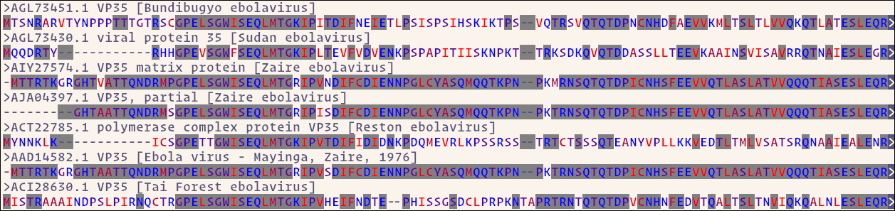

# seqcol

Sequence colorizer, with emphasis on biological sequences.
Commandline tool that adds ANSI codes to a text input using customizable per-character colorschemes.
```bash
seqcol ./tests/data/ebola_virus_reduced_align.fa1 -S hydrophobicity -c gray
```


## Install

```bash
cargo install --git ...
```

## Building

Build requires Rust and Cargo
https://doc.rust-lang.org/cargo/getting-started/installation.html
```bash
cargo build --release
```
