# seqcol

Colorize characters, with emphasis on biological sequences.
Commandline tool that adds ANSI codes to a text input using customizable per-character colorschemes.

## Demo

Colour the permissions of `ls -l`, and underline the permissions that differ from most files:
```bash
ls -l | seqcol -e '^[-dl]\S+' -S permissions.toml -s contrast -M underline
```
`permissions.toml`:
```toml
[colors]
r = "#4caf50"
w = "#e53935"
x = "#1e88e5"
"-" = "#bdbdbd"
d = "#8e24aa"
l = "#00acc1"
```


Colour a protein alignment by hydrophobicity, with gaps in grey and the consensus underlined:
```bash
seqcol examples/ebola_alignment.faa -S hydrophobicity -s contrast -s gaps -c underline
```


More examples: [examples/README.md](examples/README.md).

## Features

- Builtin colorschemes for text, and for DNA, RNA and protein, with the sequence type detected per column.
- Custom colorschemes in TOML.
- Colour only part of the text, e.g. restriction sites or sequences in a table.
- Highlight the consensus or the mismatches of an alignment, or of any aligned text.
- FASTA, FASTQ and gzip input.

All options: `seqcol --help`.

## Install

Requires [Rust and Cargo](https://doc.rust-lang.org/cargo/getting-started/installation.html).
- From GitHub: `cargo install --git https://github.com/degnbol/seqcol`
- From a clone: `cargo install --path .`

## License

MIT
