# Examples

Each command runs in this folder. `NAME.svg.sh` renders `NAME.svg`.

## Text

### File permissions

Colour the permissions of `ls -l`, and underline the permissions that differ from most files:
```bash
seqcol permissions.txt -e '^[-dl]\S+' -S permissions.toml -s contrast -M underline
```

### Versions

Underline the version characters that differ from most environments:
```bash
seqcol versions.txt -e '[0-9.]+$' -M underline
```

### Feature flags

Background colours for the flags 0 and 1, and the flags that differ from most hosts underlined:
```bash
seqcol flags.txt -e '[01]{16}$' -S flags.toml -s contrast -M underline
```

### Game map

A background colour for each tile of an ASCII game map:
```bash
seqcol map.txt -S map.toml
```

### Image tags

Underline the image tags that differ from the other pods.
`pods.txt` is the output of `kubectl get pods --no-headers -o 'custom-columns=NAME:.metadata.name,IMAGE:.spec.containers[0].image'`.
```bash
seqcol pods.txt -e '\S+$' -M underline
```

### One character

Colour only # in red, with the custom colorscheme file `hash.toml`:
```bash
seqcol -s hash.toml script.sh
```

### Black background

Default text colours on a black background:
```bash
seqcol -s character_class -S black script.sh
```

### Colours from code points

Show the colour that each character encodes in its code point, and hide the characters:
```bash
seqcol -S bits_rgb -H ^ art.txt
```

## Biological sequences

### Builtin colorschemes

List the builtin colorschemes:
```bash
seqcol -l
```

### Background colours

Background colours from a builtin colorscheme:
```bash
seqcol -S clustal ebola_alignment.faa
```

### Hydrophobicity and consensus

Colour a protein alignment by hydrophobicity, with gaps in grey and the consensus underlined:
```bash
seqcol ebola_alignment.faa -S hydrophobicity -s contrast -s gaps -c underline
```

### Consensus

Bold the consensus character of each column of an alignment:
```bash
seqcol -c bold ebola_alignment.faa
```

### Mismatches

Red background on the characters that differ from the consensus:
```bash
seqcol -M red ebola_alignment.faa
```

### Restriction sites

Colour only the EcoRI restriction sites:
```bash
seqcol -e GAATTC genome.fna
```

### Text colours on background colours

Black or white text, gaps in grey, on taylor background colours:
```bash
seqcol -s contrast -s gaps -S taylor ebola_alignment.faa
```

### Transpose

Swap columns and rows:
```bash
seqcol -T ebola_alignment.faa
```
